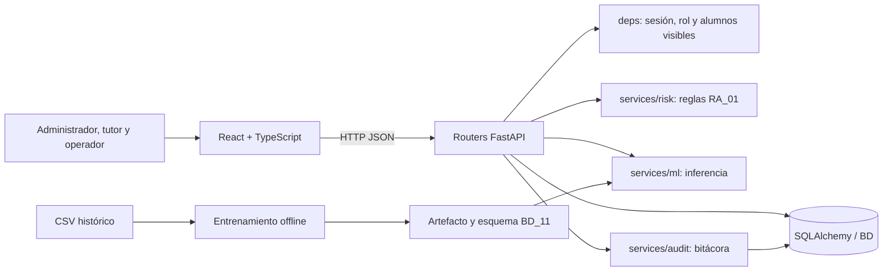

# ARQ_01 · Arquitectura de SIPDE

SIPDE es un monolito modular. React consume la API JSON de FastAPI con JWT Bearer. SQLAlchemy mantiene los expedientes y la bitácora en SQLite o PostgreSQL. El entrenamiento se ejecuta fuera del servidor HTTP.

## Capas y contratos

| Ubicación bajo `backend/app/` | Responsabilidad |
|---|---|
| `main.py`, `config.py` | Ensamblan FastAPI, CORS y el ciclo de vida. Al iniciar se validan JWT y credenciales, se crean tablas si `AUTO_CREATE_TABLES=true` y se crea la cuenta administradora inicial si falta. |
| `deps.py`, `security.py` | RF_01 / RF_02 / RN_04. Verifican firma y vencimiento y consultan la cuenta activa en cada solicitud. El rol vigente y la asignación actual determinan el acceso. |
| `routers/auth.py`, `users.py`, `health.py` | CU_01. Sesiones, contraseña propia, administración de cuentas y salud pública. |
| `routers/students.py`, `catalogs.py`, `enrollments.py` | CU_02 / CU_03. Expedientes y actividad laboral, catálogos, inscripciones y captura de notas. |
| `routers/alerts.py`, `ml.py`, `dashboard.py`, `followups.py`, `audit.py` | CU_04–CU_06. Aplican el alcance del usuario a las alertas, inferencias e historial, indicadores, tutorías y bitácora. |
| `routers/imports.py`, `reports.py` | RF_07 / RF_13. Routers registrados y reservados para Tarea G. |
| `schemas.py`, `models.py`, `database.py` | Validan los contratos HTTP y definen entidades, restricciones y sesiones SQL. BD_05 reside en `Enrollment.grade`, BD_10 en los campos laborales del alumno y BD_11 en el artefacto local. |
| `services/risk.py`, `services/ml.py` | RN_01 / RN_05. RA_01 evalúa notas y trabajo. El predictor usa las variables del esquema del modelo y produce una estimación estadística independiente. |
| `services/audit.py` | RNF_03 / RNF_05. Los cambios y su evento BD_12 comparten transacción. Una inferencia exitosa guarda también BD_07 con la fecha y la versión emitidas (RN_03). |

`create_all` crea tablas faltantes. Una base anterior a INT_02 requiere migrar sus columnas y restricciones antes de usar esta versión. Las migraciones Alembic y la carga de datos de demostración corresponden a otra tarea.

## RN_04 / RNF_01 · Permisos

| Operación | ACT_01 admin | ACT_03 operador | ACT_02 tutor |
|---|---|---|---|
| Listar, crear, editar o desactivar usuarios | Sí | — | — |
| Consultar su cuenta y cambiar su contraseña | Sí | Sí | Sí |
| Leer carreras, periodos y materias | Sí | Sí | Sí |
| Crear, editar o desactivar catálogos | Sí | — | — |
| Leer estudiantes | Todos | Todos | Asignados |
| Crear o editar expedientes y datos laborales | Sí | Sí | — |
| Baja lógica, reactivación o asignación de tutor | Sí | — | — |
| Leer inscripciones y calificaciones | Todos | Todos | Asignados |
| Crear, editar o eliminar inscripciones y calificaciones | Sí | Sí | — |
| Leer alerta RA_01 | Todos | Todos | Asignados |
| Crear seguimiento | Sí | — | Asignados |
| Leer seguimiento | Todos | Todos | Asignados |
| Solicitar predicción ML | Sí | — | Sí. Si indica alumno, debe estar asignado |
| Consultar historial de predicciones | Todo | — | De asignados |
| Leer modelo y esquema ML | Sí | Sí | Sí |
| Consultar dashboard | Global | Global | Indicadores de asignados |
| Consultar bitácora | Sí | — | — |

Las rutas públicas son salud y login. La API devuelve 401 por sesión inválida, 403 por operación prohibida al rol y 404 cuando un alumno queda fuera del alcance de un tutor. En el dashboard del tutor, el contador de materias corresponde a las materias distintas en las inscripciones de sus alumnos. El dashboard global del operador incluye los cinco resúmenes ML previstos por RF_12.

Los ejemplos por operación están en el [contrato de la API](contrato-api.md). FastAPI publica el esquema de esta versión en `/openapi.json` y la interfaz de consulta en `/docs`.
