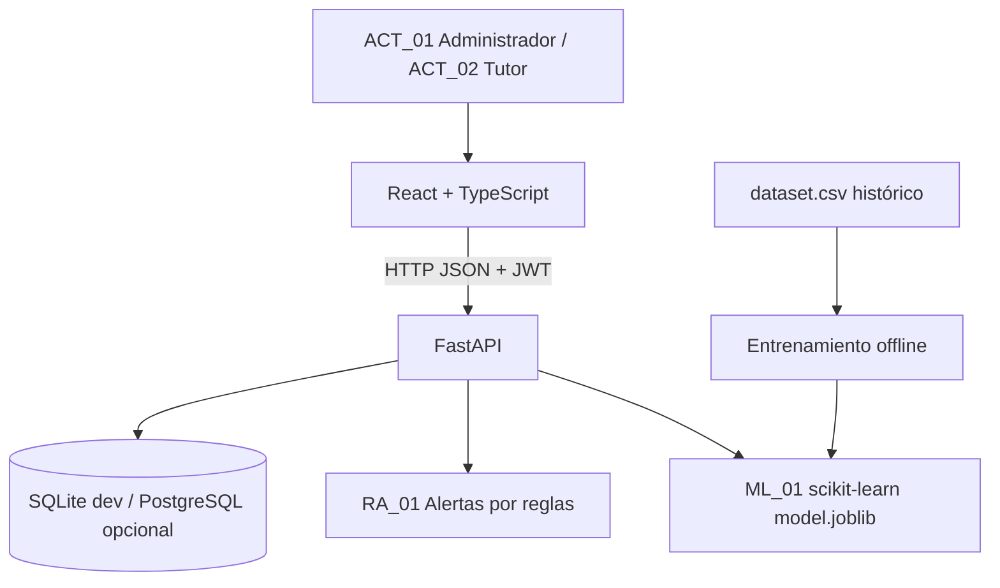

# ARQ_01 — Arquitectura de SIPDE

Backend usa módulos `config`, `models`, `schemas`, `security` y `services`. Frontend concentra el cliente HTTP en `src/api.ts` y la interfaz en `src/App.tsx` (dividir por módulos en sprint 2). El contrato del API se documenta automáticamente en `/docs`.

**Decisión arquitectónica:** monolito modular sin microservicios. Autenticación inicial JWT, pruebas y CI. Falta migración Alembic, permisos granulares, registro de auditoría, copias de seguridad y seguridad para producción.
