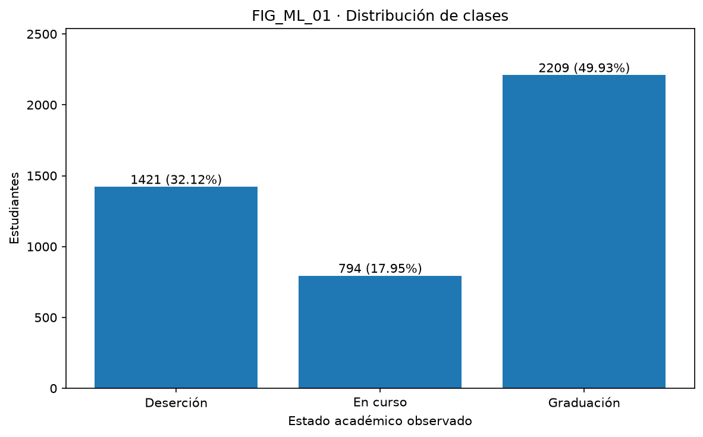
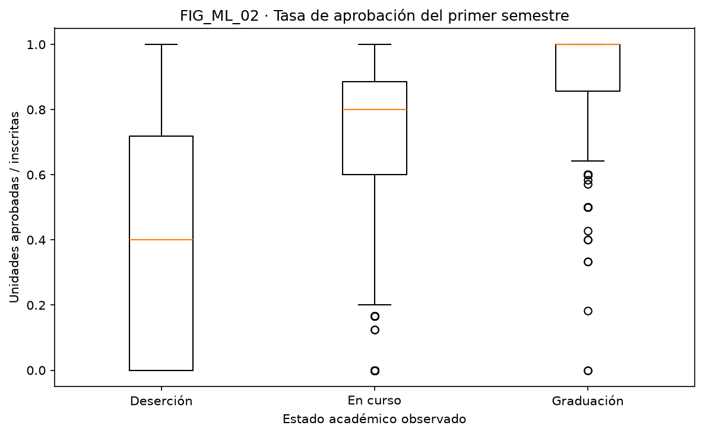
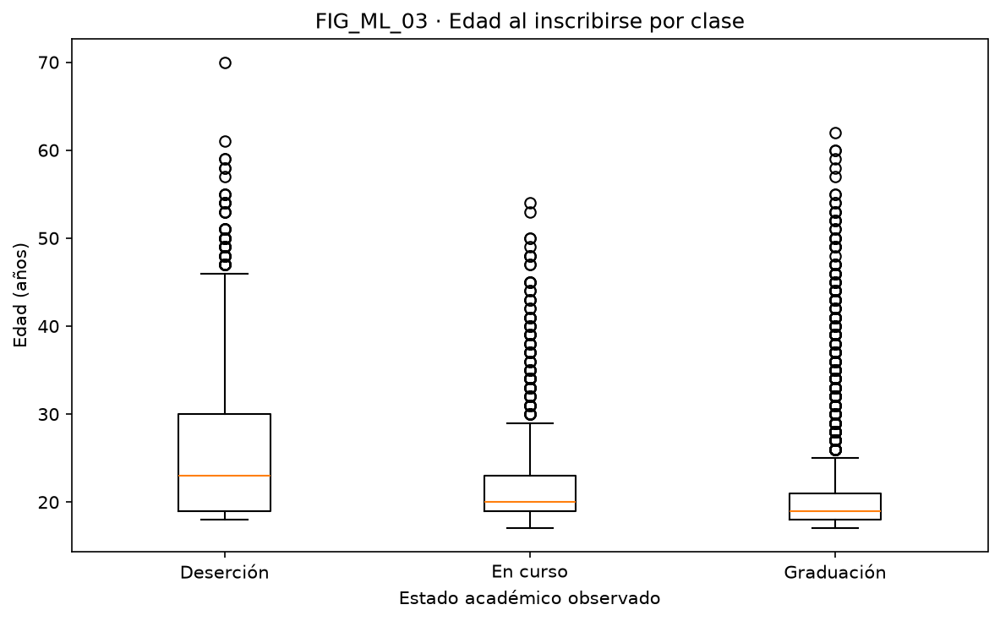
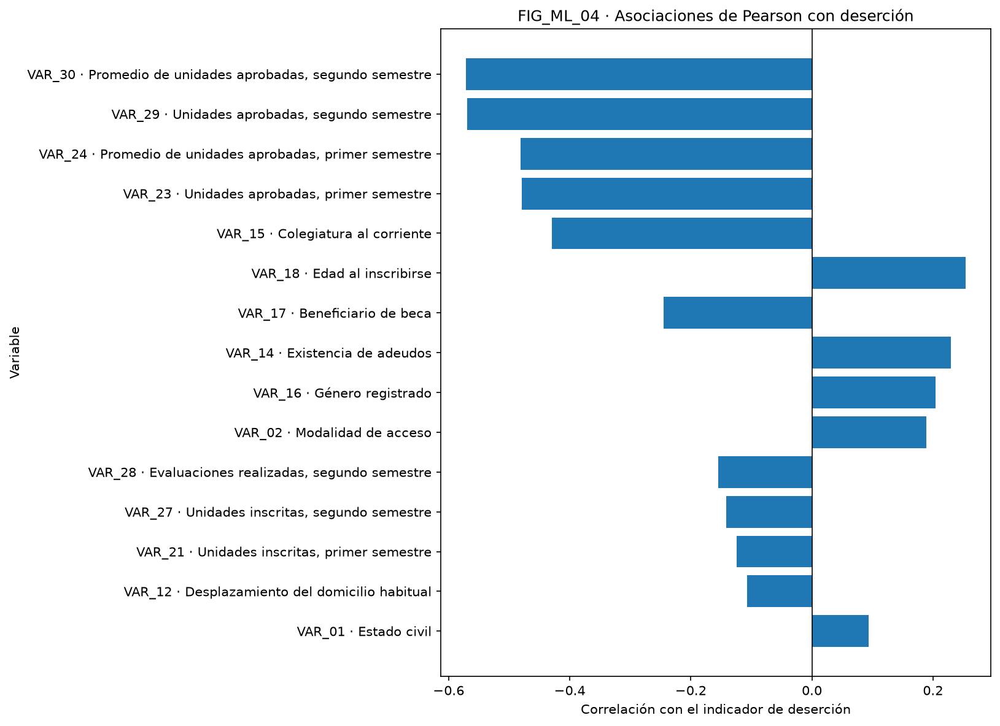
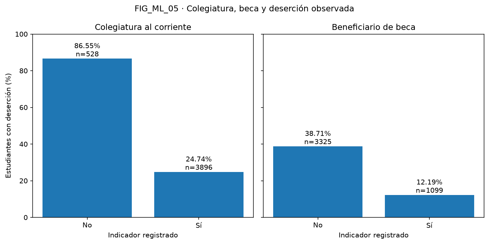

# ML_01 · Auditoría del dataset · SIPDE / INT_03

Se analizaron 4424 filas, 35 columnas y 34 variables predictoras. pandas: 2.3.3.
SHA-256 del CSV: `6bcfb6b3c826c4b8b9c7a99c063762748f6f462e24aabd26719ec2e55fed6135`.

## Calidad de datos

Nulos totales: 0; filas duplicadas completas: 0. Se conserva el CSV original. La lectura elimina el BOM UTF-8 y espacios exteriores de los encabezados; no imputa ni modifica Target. Los rangos observados no equivalen a límites clínicos ni validaciones universales.
El perfil JSON contiene nulos, tipos y mínimo/máximo/media de cada variable. La media de códigos nominales carece de interpretación ordinal; para Target las estadísticas numéricas son nulas.

### TAB_ML_01 · Variables por momento de observación

| Momento | Cantidad | Conjuntos |
|---|---:|---|
| inscripción | 19 | temprano y completo |
| 1er semestre | 6 | temprano y completo |
| 2º semestre | 6 | completo |
| macroeconómica | 3 | temprano y completo |

El diccionario contiene una fila por VAR_xx. Detalle de rangos observados:

| ID | Variable | Tipo | Mínimo | Máximo |
|---|---|---|---:|---:|
| VAR_01 | Estado civil | nominal | 1 | 6 |
| VAR_02 | Modalidad de acceso | nominal | 1 | 18 |
| VAR_03 | Orden de preferencia de la solicitud | numérica | 0 | 9 |
| VAR_04 | Carrera cursada | nominal | 1 | 17 |
| VAR_05 | Asistencia diurna o nocturna | binaria | 0 | 1 |
| VAR_06 | Titulación previa | nominal | 1 | 17 |
| VAR_07 | Nacionalidad | nominal | 1 | 21 |
| VAR_08 | Escolaridad materna | nominal | 1 | 29 |
| VAR_09 | Escolaridad paterna | nominal | 1 | 34 |
| VAR_10 | Ocupación materna | nominal | 1 | 32 |
| VAR_11 | Ocupación paterna | nominal | 1 | 46 |
| VAR_12 | Desplazamiento del domicilio habitual | binaria | 0 | 1 |
| VAR_13 | Necesidades educativas especiales | binaria | 0 | 1 |
| VAR_14 | Existencia de adeudos | binaria | 0 | 1 |
| VAR_15 | Colegiatura al corriente | binaria | 0 | 1 |
| VAR_16 | Género registrado | binaria | 0 | 1 |
| VAR_17 | Beneficiario de beca | binaria | 0 | 1 |
| VAR_18 | Edad al inscribirse | numérica | 17 | 70 |
| VAR_19 | Condición de estudiante internacional | binaria | 0 | 1 |
| VAR_20 | Unidades reconocidas, primer semestre | numérica | 0 | 20 |
| VAR_21 | Unidades inscritas, primer semestre | numérica | 0 | 26 |
| VAR_22 | Evaluaciones realizadas, primer semestre | numérica | 0 | 45 |
| VAR_23 | Unidades aprobadas, primer semestre | numérica | 0 | 26 |
| VAR_24 | Promedio de unidades aprobadas, primer semestre | numérica | 0 | 18.875 |
| VAR_25 | Unidades sin evaluación, primer semestre | numérica | 0 | 12 |
| VAR_26 | Unidades reconocidas, segundo semestre | numérica | 0 | 19 |
| VAR_27 | Unidades inscritas, segundo semestre | numérica | 0 | 23 |
| VAR_28 | Evaluaciones realizadas, segundo semestre | numérica | 0 | 33 |
| VAR_29 | Unidades aprobadas, segundo semestre | numérica | 0 | 20 |
| VAR_30 | Promedio de unidades aprobadas, segundo semestre | numérica | 0 | 18.5714 |
| VAR_31 | Unidades sin evaluación, segundo semestre | numérica | 0 | 12 |
| VAR_32 | Tasa de desempleo | numérica | 7.6 | 16.2 |
| VAR_33 | Tasa de inflación | numérica | -0.8 | 3.7 |
| VAR_34 | Variación del producto interno bruto | numérica | -4.06 | 3.51 |

## Desbalance y hallazgos

- FIG_ML_01: Dropout (Deserción): 1421 estudiantes (32.1203%).
- FIG_ML_01: Enrolled (En curso): 794 estudiantes (17.9476%).
- FIG_ML_01: Graduate (Graduación): 2209 estudiantes (49.9322%).

Razón entre clase mayoritaria y minoritaria: 2.7821. Se usan pesos balanceados y F1-macro para no ocultar clases pequeñas.

- FIG_ML_02 / FIG_ML_03, Dropout: mediana de aprobación 0.4000; mediana de edad 23.00 años.
- FIG_ML_02 / FIG_ML_03, Enrolled: mediana de aprobación 0.8000; mediana de edad 20.00 años.
- FIG_ML_02 / FIG_ML_03, Graduate: mediana de aprobación 1.0000; mediana de edad 19.00 años.

FIG_ML_02 excluye de la razón 180 casos sin unidades inscritas; se conservan en el dataset y en el entrenamiento. No se sustituye la razón indefinida por cero.

- FIG_ML_04: VAR_30 (Promedio de unidades aprobadas, segundo semestre), r=-0.571792.
- FIG_ML_04: VAR_29 (Unidades aprobadas, segundo semestre), r=-0.569500.
- FIG_ML_04: VAR_24 (Promedio de unidades aprobadas, primer semestre), r=-0.480669.

Estas correlaciones son exploratorias, no causales. Pearson sobre códigos nominales depende de su numeración arbitraria; el pipeline los codifica por separado.

- FIG_ML_05: Colegiatura al corriente, indicador 0: 457/528 casos de deserción (86.5530%).
- FIG_ML_05: Colegiatura al corriente, indicador 1: 964/3896 casos de deserción (24.7433%).
- FIG_ML_05: Beneficiario de beca, indicador 0: 1287/3325 casos de deserción (38.7068%).
- FIG_ML_05: Beneficiario de beca, indicador 1: 134/1099 casos de deserción (12.1929%).

## Limitaciones y procedencia

Datos del Instituto Politécnico de Portalegre, Portugal, de 2008–2019; no representan ESCOM. No hay horas de trabajo ni calificaciones por materia. El segundo semestre implica predicción tardía. Enrolled indica continuidad de estudios al observar el objetivo, no riesgo intermedio; No_Dropout tampoco garantiza graduación futura. Gender y Nacionality son variables sensibles: su inclusión puede reproducir sesgos y requiere evaluación por subgrupos y validación local antes de uso real. Estas probabilidades no son un diagnóstico ni justifican decisiones punitivas. Los estados de beca, deuda y colegiatura se agrupan con inscripción según el diseño solicitado, pero el CSV no incluye sus fechas de captura: debe verificarse su disponibilidad histórica.
La auditoría exploratoria usa todo el CSV para describirlo; las rejillas y conjuntos se fijan en ML_00 y no se seleccionan por asociaciones del test.
La captura transversal no permite validar cronológicamente el horizonte ni identificar reingresos. No se asignan significados de categorías individuales sin un mapeo verificado.
ML_01 · Nota de procedencia: el CSV local tiene 34 predictores, mientras la ficha actual de [UCI](https://archive.ics.uci.edu/dataset/697/predict+students+dropout+and+academic+success) reporta 36 e incluye `Previous qualification (grade)` y `Admission grade`, ausentes aquí. Por eso se fija el SHA-256 del archivo usado; no se añaden variables ausentes. El [descriptor de Realinho et al.](https://doi.org/10.3390/data7110146) documenta la procedencia y los momentos de observación.

