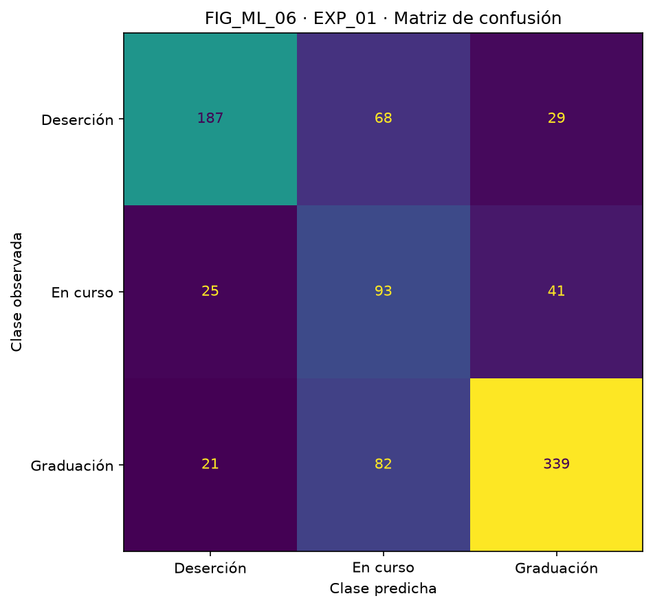
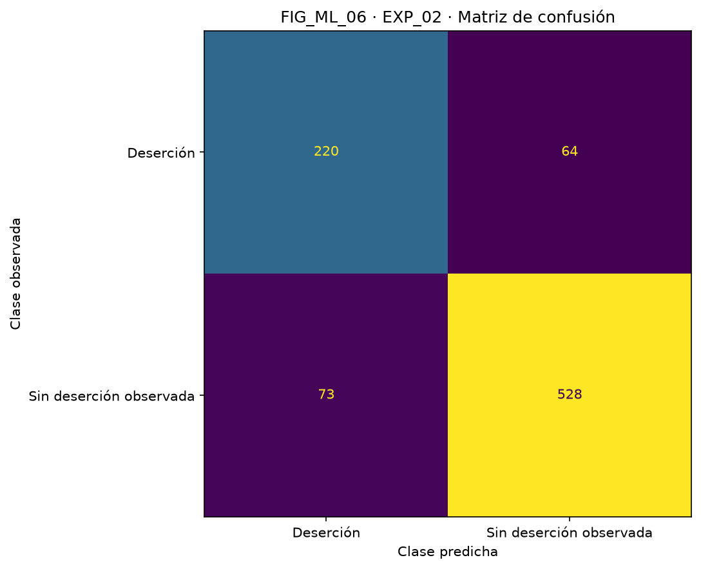
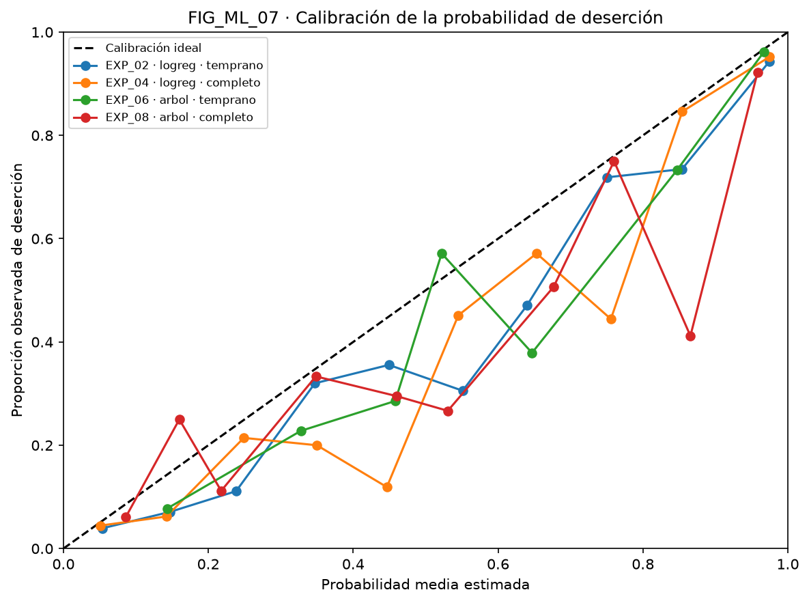
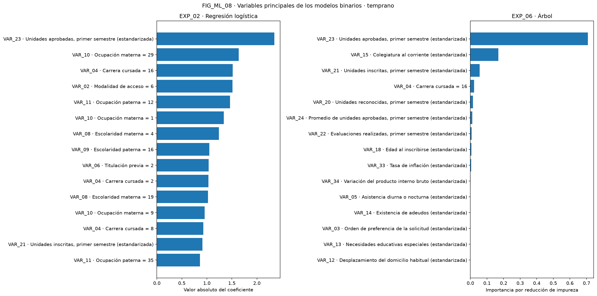
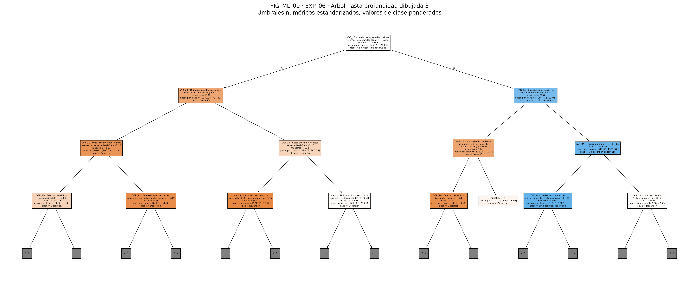
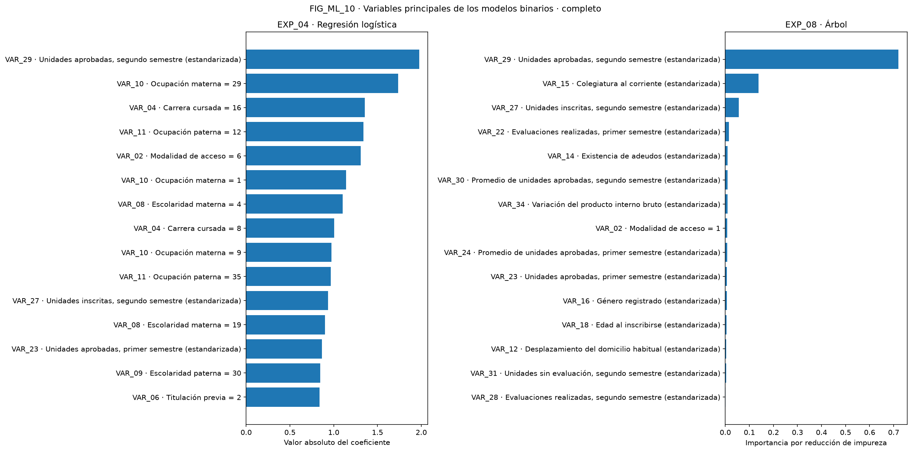

# ML_02 · Comparativa de modelos · SIPDE / INT_03

Orden fijo: modelo (logreg, arbol), conjunto (temprano, completo), tarea (multiclase, binaria). Cada combinación recibe su EXP_xx en ese orden.
Se reserva test antes de ajustar imputadores, escaladores y categorías. La búsqueda usa F1-macro y solo train; el recall de desempate se calcula por CV del mejor estimador, también exclusivamente en train. Test se predice una vez por experimento.
Semilla: 42. SHA-256: `6bcfb6b3c826c4b8b9c7a99c063762748f6f462e24aabd26719ec2e55fed6135`. scikit-learn: 1.9.1; pandas: 2.3.3.

## TAB_ML_02 · Resultados de los experimentos

EXP_00 es una referencia trivial (DummyClassifier, strategy=prior): usa la tarea binaria, el conjunto temprano y la misma partición; no participa en la selección.

| ID | Modelo | Conjunto | Tarea | F1-macro CV ± DE | Recall Dropout CV | F1-macro test | Recall Dropout test | Precisión Dropout test | Exactitud | Exactitud balanceada | F1 Dropout | ROC-AUC | Brier Dropout |
|---|---|---|---|---:|---:|---:|---:|---:|---:|---:|---:|---:|---:|
| EXP_00 | dummy_prior (referencia trivial) | temprano | binaria | 0.404309 ± 0.000227 | 0.000000 | 0.404441 | 0.000000 | 0.000000 | 0.679096 | 0.500000 | 0.000000 | 0.500000 | 0.217925 |
| EXP_01 | logreg | temprano | multiclase | 0.683787 ± 0.020902 | 0.693010 | 0.660934 | 0.658451 | 0.802575 | 0.699435 | 0.670108 | 0.723404 | 0.859505 | 0.109175 |
| EXP_02 | logreg | temprano | binaria | 0.829781 ± 0.009661 | 0.800336 | 0.823864 | 0.774648 | 0.750853 | 0.845198 | 0.826592 | 0.762565 | 0.909259 | 0.109551 |
| EXP_03 | logreg | completo | multiclase | 0.718924 ± 0.018824 | 0.735231 | 0.697241 | 0.686620 | 0.822785 | 0.732203 | 0.711442 | 0.748560 | 0.882758 | 0.100483 |
| EXP_04 | logreg | completo | binaria | 0.846167 ± 0.009865 | 0.817942 | 0.859611 | 0.820423 | 0.800687 | 0.876836 | 0.861958 | 0.810435 | 0.918897 | 0.098673 |
| EXP_05 | arbol | temprano | multiclase | 0.631077 ± 0.014115 | 0.619963 | 0.607334 | 0.570423 | 0.814070 | 0.628249 | 0.625531 | 0.670807 | 0.818497 | 0.134017 |
| EXP_06 | arbol | temprano | binaria | 0.800307 ± 0.004826 | 0.760758 | 0.792972 | 0.753521 | 0.697068 | 0.815819 | 0.799390 | 0.724196 | 0.870653 | 0.131910 |
| EXP_07 | arbol | completo | multiclase | 0.670108 ± 0.015832 | 0.676308 | 0.646236 | 0.598592 | 0.862944 | 0.672316 | 0.663668 | 0.706861 | 0.826825 | 0.121888 |
| EXP_08 | arbol | completo | binaria | 0.825238 ± 0.019844 | 0.761701 | 0.821293 | 0.771127 | 0.747440 | 0.842938 | 0.823999 | 0.759099 | 0.889758 | 0.118149 |

ROC-AUC binaria usa Dropout como positivo; multiclase usa OVR macro. Brier siempre compara el indicador Dropout con su probabilidad. Las matrices están en orden de classes. La partición es idéntica entre modelos y conjuntos de una misma tarea; al reagrupar el objetivo cambia la estratificación, por lo que no se comparan las tareas como si compartieran todos los individuos de test.

## Selección automática dentro del horizonte temprano según ML_00

### multiclase: EXP_01

Se selecciona logreg / temprano: F1-macro CV 0.683787 ± 0.020902; recall Dropout CV 0.693010. El máximo de la tarea en temprano es EXP_01 con 0.683787; la diferencia es 0.000000. Ningún árbol alcanza el margen de 0.01; se conserva el máximo de CV.
El mejor árbol es EXP_05, con F1-macro CV 0.631077; su distancia al máximo es 0.052710.
Entrenamiento: 3539 filas; prueba: 885. Hiperparámetros: `{'classifier__C': 0.1}`.

Matriz de confusión de EXP_01; filas observadas, columnas predichas:

| Clase | Deserción | En curso | Graduación |
|---|---:|---:|---:|
| Deserción | 187 | 68 | 29 |
| En curso | 25 | 93 | 41 |
| Graduación | 21 | 82 | 339 |

### binaria: EXP_02

Se selecciona logreg / temprano: F1-macro CV 0.829781 ± 0.009661; recall Dropout CV 0.800336. El máximo de la tarea en temprano es EXP_02 con 0.829781; la diferencia es 0.000000. Ningún árbol alcanza el margen de 0.01; se conserva el máximo de CV.
El mejor árbol es EXP_06, con F1-macro CV 0.800307; su distancia al máximo es 0.029474.
Entrenamiento: 3539 filas; prueba: 885. Hiperparámetros: `{'classifier__C': 1}`.

Matriz de confusión de EXP_02; filas observadas, columnas predichas:

| Clase | Deserción | Sin deserción observada |
|---|---:|---:|
| Deserción | 220 | 64 |
| Sin deserción observada | 73 | 528 |

## Candidata para el sistema

Se recomienda EXP_02 (logreg, temprano, binaria). ML_00 fija el horizonte temprano como decisión de producto ANTES de comparar: la alerta debe estar disponible al cierre del primer semestre. Dentro de ese horizonte se selecciona por F1-macro de CV y el desempate predefinido. La multiclase se conserva como comparación.
EXP_04 es una referencia de techo con datos del segundo semestre: unidades inscritas o aprobadas iguales a cero pueden reflejar deserciones ya ocurridas y proximidad al objetivo. No satisface el horizonte de producción.
Frente a EXP_04, el costo de anticipar con EXP_02 es 0.016386 de F1-macro CV y 0.017606 de recall Dropout CV; en test es 0.035746 de F1-macro y 0.045775 de recall Dropout (diferencias EXP_04 menos EXP_02; un signo negativo indica mejora al anticipar). EXP_02 test: F1-macro 0.823864, recall 0.774648; EXP_04 test: F1-macro 0.859611, recall 0.820423.
La recomendación es experimental: no certifica calibración ni desempeño en ESCOM. Los pesos balanceados pueden alterar la calibración; FIG_ML_07 y Brier describen esa limitación. Las curvas de test son descriptivas: no se ajustó calibrador ni umbral con ellas.

## Interpretación y limitaciones

FIG_ML_08 interpreta EXP_02 (modelo de producción) y EXP_06 en el horizonte temprano: muestra los 15 mayores valores absolutos de coeficientes de la regresión y las 15 mayores importancias del árbol tras el preprocesamiento. La principal salida de EXP_02 por |coef| es VAR_23 · Unidades aprobadas, primer semestre (estandarizada) (2.347585); en EXP_06 es VAR_23 · Unidades aprobadas, primer semestre (estandarizada) (70.77% de la importancia total). Las categorías aparecen con su código observado y las numéricas con su escala estandarizada. El valor absoluto oculta el signo del coeficiente; estas escalas no son comparables entre modelos ni implican causalidad.
FIG_ML_09 representa EXP_06, árbol binario temprano, hasta profundidad dibujada 3; trunca solo el dibujo, no el modelo. Los umbrales numéricos están estandarizados y los conteos de clase incluyen pesos balanceados.
FIG_ML_10 conserva EXP_04 y EXP_08, binarios del conjunto completo. En EXP_08, VAR_29 · Unidades aprobadas, segundo semestre (estandarizada) concentra 71.98% de la importancia total por reducción de impureza. Su uso de información del segundo semestre evidencia proximidad al objetivo y disponibilidad tardía; no justifica incorporarla al horizonte de producción.

### Soporte de categorías nominales en el top 15 de EXP_02

Advertencia: las categorías nominales con poco soporte pueden recibir coeficientes grandes en la regresión. Un |coef| alto no garantiza una asociación estable. Se cuenta el código observado en las filas originales de train de la partición binaria, sin incluir test ni contar imputaciones como observaciones del código.

| Categoría del top 15 por coeficiente absoluto | Registros de train con ese código |
|---|---:|
| VAR_10 · Ocupación materna = 29 | 19 |
| VAR_04 · Carrera cursada = 16 | 144 |
| VAR_02 · Modalidad de acceso = 6 | 21 |
| VAR_11 · Ocupación paterna = 12 | 54 |
| VAR_10 · Ocupación materna = 1 | 120 |
| VAR_08 · Escolaridad materna = 4 | 37 |
| VAR_09 · Escolaridad paterna = 16 | 2 |
| VAR_06 · Titulación previa = 2 | 21 |
| VAR_04 · Carrera cursada = 2 | 179 |
| VAR_08 · Escolaridad materna = 19 | 110 |
| VAR_10 · Ocupación materna = 9 | 24 |
| VAR_04 · Carrera cursada = 8 | 116 |
| VAR_11 · Ocupación paterna = 35 | 4 |

Datos del Instituto Politécnico de Portalegre, Portugal, de 2008–2019; no representan ESCOM. No hay horas de trabajo ni calificaciones por materia. El segundo semestre implica predicción tardía. Enrolled indica continuidad de estudios al observar el objetivo, no riesgo intermedio; No_Dropout tampoco garantiza graduación futura. Gender y Nacionality son variables sensibles: su inclusión puede reproducir sesgos y requiere evaluación por subgrupos y validación local antes de uso real. Estas probabilidades no son un diagnóstico ni justifican decisiones punitivas. Los estados de beca, deuda y colegiatura se agrupan con inscripción según el diseño solicitado, pero el CSV no incluye sus fechas de captura: debe verificarse su disponibilidad histórica.
La CV usada para seleccionar hiperparámetros no es anidada; su mejor puntuación puede ser optimista. El test queda fuera de esa selección y solo estima desempeño en esta población. La incertidumbre entre pliegues no es un intervalo de confianza poblacional.

Hiperparámetros de cada experimento:

- EXP_00: `{'strategy': 'prior'}`.
- EXP_01: `{'classifier__C': 0.1}`.
- EXP_02: `{'classifier__C': 1}`.
- EXP_03: `{'classifier__C': 0.1}`.
- EXP_04: `{'classifier__C': 1}`.
- EXP_05: `{'classifier__max_depth': 6, 'classifier__min_samples_leaf': 1}`.
- EXP_06: `{'classifier__max_depth': 4, 'classifier__min_samples_leaf': 30}`.
- EXP_07: `{'classifier__max_depth': 5, 'classifier__min_samples_leaf': 1}`.
- EXP_08: `{'classifier__max_depth': 5, 'classifier__min_samples_leaf': 10}`.
